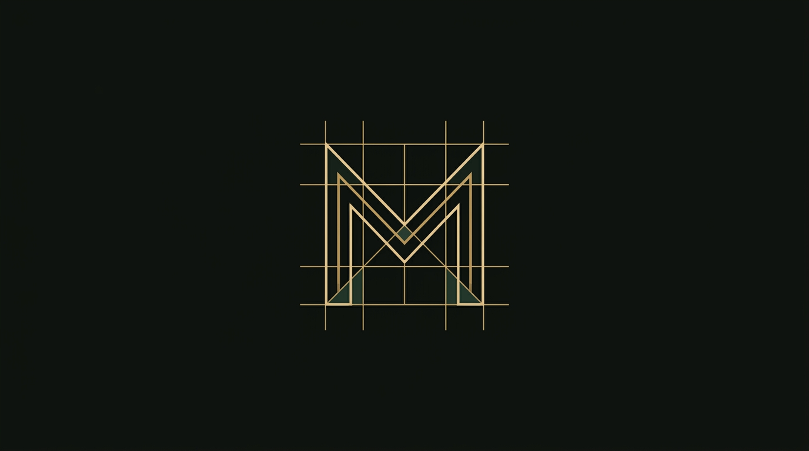
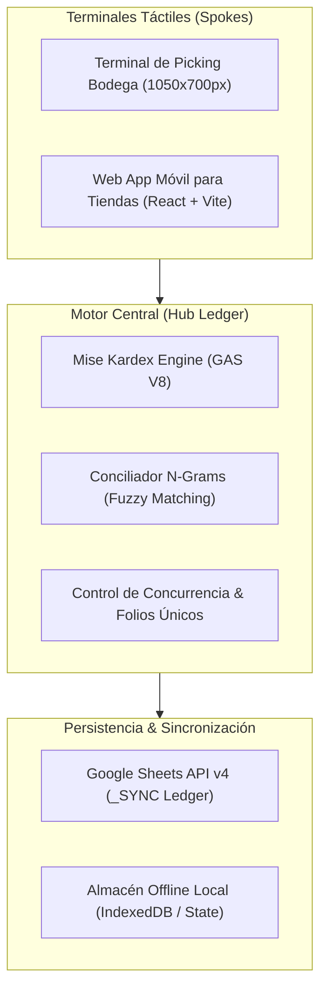

  

# ⚡ mise en place
### Enterprise Inventory, Supply Chain Ledger & Touch Picking Engine

*Motor distribuido de control de inventarios, conciliación inteligente de insumos (Fuzzy Matching con N-Grams) y terminales de picking táctil para operaciones de alta velocidad en cocinas y bodegas.*

---

## 🏗️ Arquitectura Hub-and-Spoke

---

## ⚡ Capacidades Principales

- **Conciliación Inteligente con N-Grams**: Resuelve discrepancias ortográficas, abreviaciones y nombres alternativos de insumos con tolerancia a variaciones de operadores en cocina.
- **Ergonomía Táctil en Zona del Pulgar**: Diseñado específicamente para pantallas táctiles de bodega y smartphones con una sola mano, eliminando scrolls innecesarios y garantizando objetivos táctiles superiores a 48px.
- **Control de Concurrencia de Folios**: Previene condiciones de carrera (*race conditions*) en transferencias simultáneas entre sucursales mediante bloqueos atómicos.
- **Motor Kardex de Doble Partida**: Registro inmutable de entradas, mermas, traspasos y consumos teóricos contra inventario físico.

---

## 📁 Estructura del Repositorio

- `engine-apps-script/`: Motor central de Kardex y diálogos de picking en Google Apps Script V8 desacoplados de identificadores privados.
- `web-app/`: Aplicación frontend en React + TypeScript y Vite con diseño modular y componentes de picking táctil.
- `identidad/`: Sistema de identidad corporativa, símbolos SVG monocromáticos y manual de diseño.

---

  Diseñado y construido con obsesión por el detalle por <a href="https://ultimaibrahim.dev">Ibrahim García</a>

